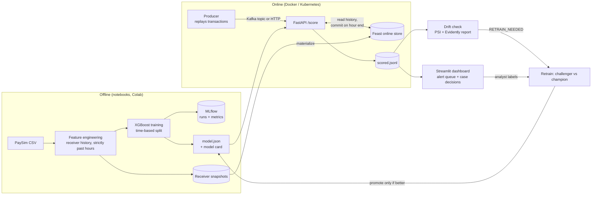

# Real-Time Financial Fraud Detection Platform

An end-to-end fraud detection system: feature engineering with a **Feast** feature store, an **XGBoost** model
tracked in **MLflow**, a **FastAPI** scoring service fed by a transaction stream (HTTP or **Kafka**),
**drift monitoring** with a retraining trigger (**Evidently** + PSI), an **analyst dashboard** (**Streamlit**),
and deployment with **Docker** and **Kubernetes (Minikube)**. A **graph neural network** (PyTorch Geometric)
was evaluated against XGBoost on a real transaction graph.

**Live demo (analyst dashboard):** https://fraud-alerts-shreyas.streamlit.app

Data: [PaySim](https://www.kaggle.com/datasets/ealaxi/paysim1) (6.36M simulated mobile-money transactions, 743 hours).
GNN experiment: [Elliptic Bitcoin dataset](https://www.kaggle.com/datasets/ellipticco/elliptic-data-set).

## Architecture



**Key design rule:** a transaction is scored only with receiver history from *earlier hours*, exactly like
training. Live updates are held back and committed to Feast when the hour ends.
`tests/replay_consistency.py` proves the live service reproduces the training features and scores.

## Results

All splits are by **time** (train on the past, test on the future). The main metric is **PR-AUC**, because fraud
is rare and accuracy would look excellent for a model that never flags anything. "Baseline" is the PR-AUC of
random guessing (equal to the fraud rate).

| Stage | Data | PR-AUC | Baseline | Precision | Recall |
|---|---|---|---|---|---|
| Model, offline test (Days 5-6) | PaySim test hours, 3.3% fraud | **0.613** | 0.033 | 0.76 | 0.41 |
| Live service replay (Days 7-8) | hours 672-695: 23,365 tx, 262 fraud | **0.537** | 0.011 | 0.56 | 0.43 |

* **Leakage found and removed.** PaySim's balance columns let a model score PR-AUC 1.0, because the simulator
  writes the fraud into them. The production model uses only the 7 receiver-history and transaction features.
* **Live = offline.** Re-scoring the replay window offline with the same model gives PR-AUC 0.537, identical to the
  live service, and `tests/replay_consistency.py` passes.
* Live precision is lower than offline mainly because fraud is rarer in that window (1.1% vs 3.3%).

### Graph neural network (Days 9-10)

PaySim has almost no account network (senders appear once; fraud money rarely reappears as a sender),
so a GNN was evaluated on the Elliptic Bitcoin graph (203,769 transactions, 234,355 payment edges),
train steps 1-27, validate 28-34, test 35-49:

| Model | Test PR-AUC (illicit) |
|---|---|
| Random guessing | 0.065 |
| XGBoost, local features | 0.753 |
| **XGBoost, all features** | **0.789** |
| GraphSAGE, local features | 0.612 |
| GraphSAGE, all features | 0.675 (seed spread ±0.017) |
| Blend 0.3 GNN + 0.7 XGBoost (weight chosen on validation) | 0.789 |

XGBoost beats the GNN by 0.114 PR-AUC, more than seed noise, and the blend adds nothing. This matches the
original Elliptic paper, where tree models beat a plain graph network. **The GNN is therefore not in the live path.**
Validation PR-AUC was about 0.98 against 0.79 on test: performance drops over time, which motivates Day 11.

### Monitoring and retraining (Day 11)

On the live replay window: 2 of 7 features drifted (PSI >= 0.2; Evidently also flags 2 of 7), below the 50% rule,
and PR-AUC was 88% of its training-time value, above the 80% rule, so **no retraining was triggered**.
A challenger retrained on newer data scored 0.542 vs the champion's 0.537 on the same unseen hours, a gain of
0.006 below the 0.01 promotion bar, so **the champion was kept**.

## Repository layout

```
notebooks/            Days 1-6 and 9-10 (run in Colab): EDA, features + Feast, XGBoost + MLflow, GNN
app/                  FastAPI service (main.py) and scoring logic (scoring.py)
feature_repo/         Feast definitions and config
scripts/              prepare_feast.py, summarize_scored.py, retrain.py
streaming/            producer.py (HTTP or Kafka), consumer.py (Kafka -> API)
monitoring/           drift_check.py
dashboard/            Streamlit analyst dashboard
tests/                replay_consistency.py
k8s/                  Kubernetes Deployment + Service
Dockerfile, docker-compose.yml (Kafka), requirements.txt, requirements-api.txt
```

## Run it locally

Use **Python 3.12** (Feast needs pandas 2, which has no installers for Python 3.15 yet).

1. Put `model.json` and `model_card.json` (Day 5-6 outputs) in `model/`, and `features_full.parquet` (Day 3-4 outputs) in `data/`.
2. Set up:

```powershell
py -3.12 -m venv venv
venv\Scripts\activate                 # macOS/Linux: source venv/bin/activate
python -m pip install -r requirements.txt
```

3. Prepare the live state, prove consistency, reset, serve, replay:

```powershell
python scripts/prepare_feast.py --start-step 672 --hours 24   # replay window: hours 672-695
python tests/replay_consistency.py                            # must print PASSED
python scripts/prepare_feast.py --start-step 672 --hours 24   # reset (the test advances the state)
python -m uvicorn app.main:app --port 8000                    # terminal 1
python streaming/producer.py --mode http --rate 0             # terminal 2
python scripts/summarize_scored.py                            # alerts vs true labels
```

With Kafka (Docker Desktop): `docker compose up -d`, then `python streaming/producer.py --mode kafka` and
`python streaming/consumer.py` instead of the HTTP producer.

4. Monitor, retrain, review:

```powershell
python monitoring/drift_check.py          # reports/drift_summary.json, reports/drift_report.html, RETRAIN_NEEDED flag
python scripts/retrain.py --dry-run       # challenger vs champion, changes nothing
python -m streamlit run dashboard/app.py  # http://localhost:8501
```

## Deploy with Docker and Kubernetes (Day 13)

The image contains the API, the model and a snapshot of the Feast online store, so run `prepare_feast.py` first.

```powershell
docker build -t fraud-api:0.1 .
docker run --rm -p 8000:8000 fraud-api:0.1          # test: http://127.0.0.1:8000/health

minikube start --driver=docker --memory=4096
minikube image load fraud-api:0.1
minikube kubectl -- apply -f k8s/deployment.yaml
minikube kubectl -- get pods                        # wait for READY 1/1
minikube service fraud-api --url                    # prints the URL to call
```

Readiness and liveness probes use `/health`. Send the replay to the cluster with
`$env:API_URL="<url from above>"; python streaming/producer.py --mode http --rate 0`.

## Limitations

* **Simulated data.** PaySim's last days contain hours with only fraud and no normal traffic; replays were run on
  hours 672-695, which mix both. One hour (684) produced about half of that window's false alarms.
* **Labels arrive instantly in the replay.** Real fraud labels come days or weeks later, so the performance
  rule in the drift check would run on a delay; the PSI rule does not need labels.
* **Single replica.** The Feast online store is a SQLite file inside the pod. Scaling out needs a shared store
  such as Redis, and state is lost on pod restart (it restarts from the baked snapshot).
* **Receiver-side features only.** Senders appear once in PaySim, so sender history is impossible.
* **Kafka path** (`docker-compose.yml`, producer `--mode kafka`, `consumer.py`) follows the standard client and image
  documentation but has not yet been run against a real broker; the HTTP path is the tested one.
